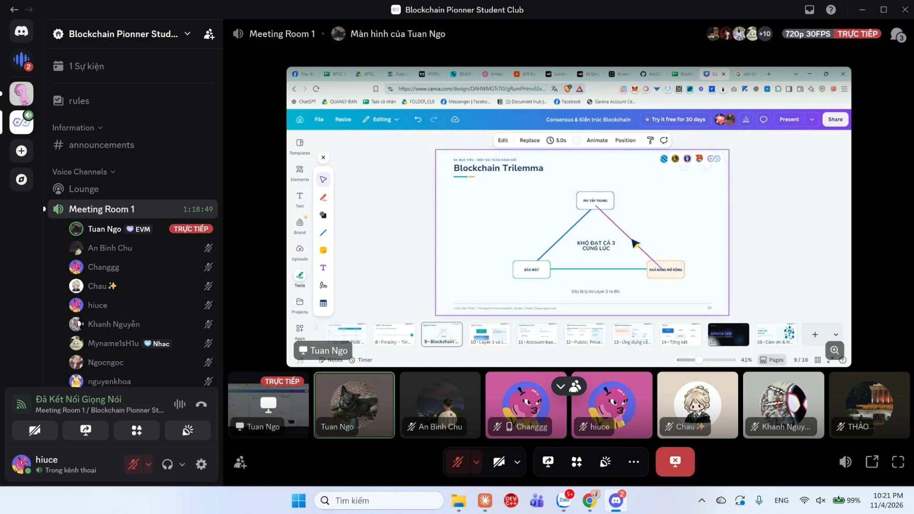

# Session 04 - Consensus & Blockchain Architecture

- **Sinh viên:** Vũ Trung Hiếu (GitHub @trghieu03)
- **Ngày nộp:** 07/11/2026
- **Commit:** `[S04] add devlog`

## 1. Summary

Buổi học về cách các node trong mạng blockchain thống nhất một trạng thái chung (consensus), các cơ chế PoW/PoS, khái niệm finality, cách mở rộng bằng Layer 1/Layer 2, hai mô hình ghi nhận số dư (Account-based, UTXO) và cách phân loại blockchain theo quyền truy cập.

## 2. Topic notes

### Consensus là gì?
- Cơ chế để nhiều node không tin nhau vẫn đồng ý về cùng một danh sách giao dịch và thứ tự block.
- Giải quyết vấn đề: không có bên trung tâm, node có thể lỗi hoặc gian lận, nên cần quy tắc chung để tránh double spending.

### Proof of Work / Proof of Stake
| | Proof of Work (PoW) | Proof of Stake (PoS) |
|---|---|---|
| Ai tạo block | Miner giải bài toán băm, ai tìm được nonce hợp lệ trước | Validator được chọn dựa trên lượng coin đã stake |
| Chi phí tấn công | Cần sức mạnh tính toán (điện, phần cứng) | Cần nắm lượng coin lớn, bị phạt (slashing) nếu gian lận |
| Năng lượng | Tốn nhiều | Tiết kiệm hơn nhiều |
| Ví dụ | Bitcoin | Ethereum (sau The Merge) |

### Finality
- Thời điểm giao dịch được coi là không thể đảo ngược.
- Probabilistic finality (Bitcoin): càng nhiều block xác nhận phía sau, khả năng bị đảo ngược càng thấp.
- Deterministic finality (nhiều chain PoS): sau khi đủ validator xác nhận thì giao dịch chốt hẳn.

### Layer 1 / Layer 2
- **Layer 1:** chain gốc (Bitcoin, Ethereum), tự chịu trách nhiệm bảo mật và đồng thuận.
- **Layer 2:** giải pháp xây trên L1 để tăng tốc và giảm phí (rollup...), xử lý giao dịch bên ngoài rồi đưa kết quả về L1 xác nhận.
- Mục đích: giải bài toán mở rộng (scalability) mà không bỏ bảo mật của L1.
- **Blockchain Trilemma:** khó đạt cả 3 cùng lúc là Bảo mật, Phi tập trung và Khả năng mở rộng. Đây là lý do Layer 2 ra đời.

### Account-based vs UTXO
| | Account-based | UTXO |
|---|---|---|
| Cách lưu | Mỗi địa chỉ có một số dư, như tài khoản ngân hàng | Lưu các "đầu ra chưa tiêu" (như tiền mặt lẻ) |
| Giao dịch | Trừ số dư người gửi, cộng số dư người nhận | Dùng UTXO cũ làm đầu vào, tạo UTXO mới (có tiền thối) |
| Ví dụ | Ethereum | Bitcoin |
| Ưu điểm | Đơn giản, hợp smart contract | Dễ kiểm tra, xử lý song song tốt |

### Public / Private / Permissioned Blockchain
- **Public:** ai cũng tham gia, đọc, xác thực được (Bitcoin, Ethereum).
- **Private:** do một tổ chức kiểm soát, quyền hạn hạn chế.
- **Permissioned:** các bên được cấp phép mới được tham gia, thường dùng trong doanh nghiệp/liên minh (ví dụ Hyperledger Fabric).

## 3. Work completed
- Tham gia buổi học trên Discord.
- Ghi chú theo sáu mục của đề cương.
- Viết devlog và đẩy lên repo bootcamp-devlog.

## 4. Evidence
- Ảnh chụp buổi học trên Discord (04/11/2026, slide Blockchain Trilemma): 
## 5. Blockers
- (để trống nếu không có)

## 6. Takeaway
Blockchain an toàn vì các node cùng tuân theo một cơ chế đồng thuận, còn PoW/PoS chỉ là hai cách đánh đổi khác nhau giữa chi phí, tốc độ và bảo mật.
