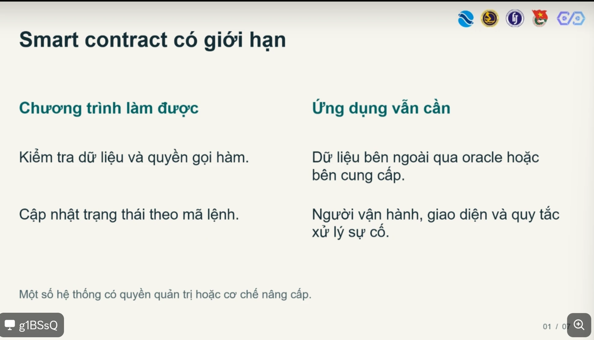

# Session 05 - Smart Contracts & Digital Assets

- **Sinh viên:** Vũ Trung Hiếu (GitHub @trghieu03)
- **Ngày nộp:** 11/11/2026
- **Commit:** `[S05] add devlog`

## 1. Summary

Buổi học về smart contract và các loại tài sản số trên blockchain: native coin và token, mint/burn, stablecoin, NFT, phí gas, và ba môi trường chạy contract (EVM, SVM, WASM) ở mức giới thiệu.

## 2. Topic notes

### Smart Contract là gì?
- Chương trình lưu trên blockchain, tự chạy khi được gọi, kết quả được mọi node xác nhận.
- Làm được: kiểm tra dữ liệu và quyền gọi hàm, cập nhật trạng thái theo mã lệnh.
- Có giới hạn: không tự lấy dữ liệu bên ngoài (cần oracle hoặc bên cung cấp); ứng dụng vẫn cần người vận hành, giao diện và quy tắc xử lý sự cố. Một số hệ thống có quyền quản trị hoặc cơ chế nâng cấp.

### Native Coin vs Token
| | Native coin | Token |
|---|---|---|
| Nằm ở đâu | Là đồng gốc của chain (ETH, SOL) | Do smart contract tạo ra trên chain có sẵn |
| Công dụng | Trả phí gas, thưởng validator | Đại diện tài sản, quyền, điểm thưởng... |
| Ví dụ | ETH, BTC | USDT, USDC (ERC-20) |

### Mint / Burn
- **Mint:** tạo thêm token mới. **Burn:** huỷ token vĩnh viễn (gửi về địa chỉ không ai dùng được).
- Dùng để điều chỉnh nguồn cung.
- Câu hỏi trên lớp: dự án burn 10% số token thì giá có chắc tăng 10% không? Không chắc. Giá phụ thuộc cầu, tâm lý thị trường và vốn hoá; burn chỉ giảm nguồn cung, nếu cầu không tăng thì giá không tăng theo tỷ lệ đó.

### Stablecoin
- Token giữ giá ổn định, thường neo theo 1 USD.
- Hai hướng chính: có tài sản bảo chứng (USDT, USDC) và thuật toán/thế chấp bằng crypto (DAI).
- Rủi ro: mất neo giá, phụ thuộc đơn vị phát hành.

### NFT
- Token không thể thay thế: mỗi token có ID riêng, khác với token thường (có thể đổi 1:1).
- Dùng cho tranh số, vật phẩm game, vé, bằng chứng sở hữu.

### Gas / Transaction Fee
- Phí trả cho mạng để xử lý giao dịch, tính theo công sức tính toán mà giao dịch cần.
- Giao dịch phức tạp (gọi contract) tốn gas hơn chuyển coin đơn giản; mạng đông thì phí tăng.

### EVM / SVM / WASM (giới thiệu)
- **EVM:** máy ảo của Ethereum, viết contract bằng Solidity.
- **SVM:** môi trường của Solana, thường viết bằng Rust.
- **WASM:** định dạng mã chạy được trên nhiều chain, dùng nhiều ngôn ngữ.

## 3. Work completed
- Tham gia buổi học trên Discord.
- Ghi chú theo bảy mục của đề cương.
- Viết devlog và đẩy lên repo bootcamp-devlog.

## 4. Evidence
- Ảnh chụp slide "Smart contract có giới hạn" trong buổi học: 
- Ảnh chụp câu hỏi về Mint/Burn trong buổi học: 

## 5. Blockers
- (để trống nếu không có)

## 6. Takeaway
Smart contract tự động hoá logic trên blockchain nhưng không tự biết dữ liệu bên ngoài, nên ứng dụng thật luôn cần thêm oracle, giao diện và người vận hành.
